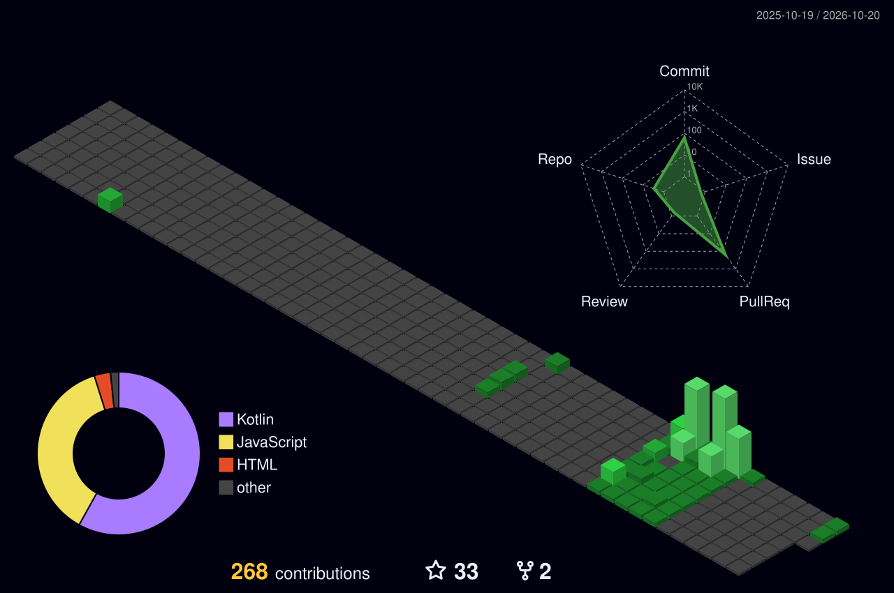

# Oi, eu sou o Matheus! 💜

**24 anos · dev · streamer · furry · também conhecido como Teuzin**

## 🐺 Sou furry desde que me lembro

Desde que me entendo por gente eu gosto de personagens antropomórficos. Nunca teve um dia em que eu "virei" furry: sempre foi parte de mim.

Quando conheci a comunidade, ela chegou com um grande abraço. Fui recebido de braços abertos, e foi por isso que decidi usar o **Teyo**, minha sona, como a cara das lives e do canal.

<table>
<tr>
<td width="200" align="center"></td>
<td>

**Teyo** é um lobo de pelagem cinza, cabelo roxo e olhos de cores diferentes (um amarelo e um verde). Ele aparece no overlay, nos alertas, no PNGtuber e na tela de "já volto" das lives. A cor oficial é o roxo `#7B2CF2`.

A comunidade se chama **matilha**. Quem chega, fica. 💜

</td>
</tr>
</table>

## 📺 Lives

- Twitch: [twitch.tv/teuzin0dev](https://twitch.tv/teuzin0dev)
- Jogos, bate-papo e programação ao vivo
- Meta atual: uma câmera e uma luz novas pras lives (apoie via [LivePix](https://livepix.gg/teuzin0dev))

## 💻 Programação

Dev com foco em front-end, graduando em Desenvolvimento de Software Multiplataforma (FATEC). Meu idioma favorito é Python, e hoje estudo Assembly, C#, Java e Node.js.

## 🎮 Pra jogar e fuçar

- [Pac-Man](https://www.teuzin.com.br/archive/jogos/PACMAN-JS/index.html) feito em JavaScript puro. Tenta bater meu recorde!
- [Meu site](https://www.teuzin.com.br): quem eu sou, onde tem live e o que eu programo
- [Arquivo do site](https://www.teuzin.com.br/archive/index.html): versões antigas do portfólio, jogos e experimentos
- [Weather App](https://dieguesmosken.github.io/WeatherApp/index.html) e [Encurtador de links](https://dieguesmosken.github.io/redirect/)

## 🖥️ Meu PC

  

## 📊 Atividade

  
  
  

  
  

fala, matilha! 🐾

