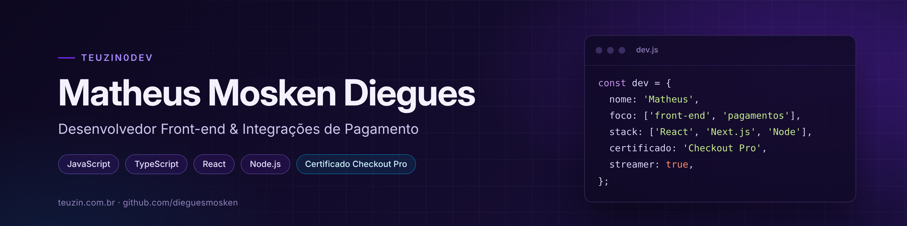
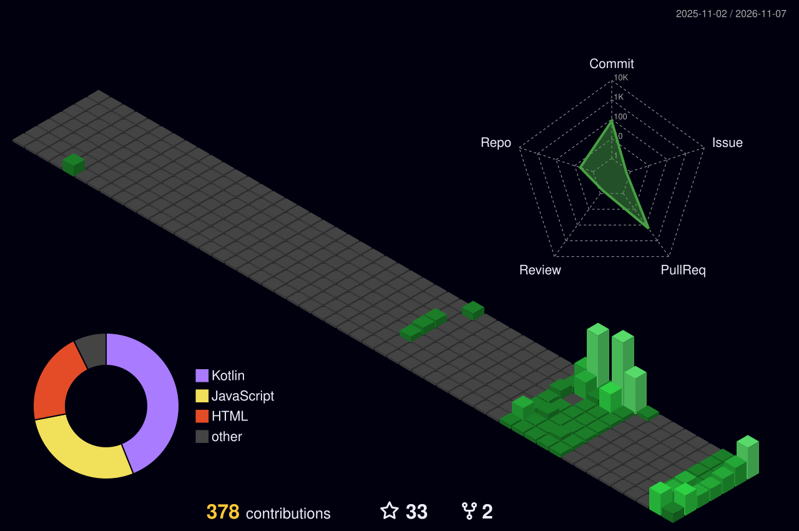

# Matheus Mosken Diegues

**Desenvolvedor Front-end · Integrações de pagamento · Ferramentas para streaming**

---

## Sobre mim

Desenvolvedor focado em front-end. Crio aplicações web e ferramentas que resolvem problemas reais, da interface à integração com APIs de terceiros.

Boa parte dos meus projetos nasce das necessidades do meu canal na Twitch e depois é disponibilizada gratuitamente para outros criadores de conteúdo.

- 💳 Certificado em **Checkout Pro** pelo Mercado Pago Developers
- 🛠️ Ferramentas gratuitas e open source para a comunidade de streaming

## Certificações

<table>
  <tr>
    <td align="center" width="140">
      
    </td>
    <td>
      <b>Checkout Pro · Mercado Pago Developers</b> 
      Integração de pagamentos online com Checkout Pro: preferências, meios de pagamento, URLs de retorno, notificações via webhook e identificação de transações. 
      Emitido em novembro de 2026 · <a href="./certificados/mercado-pago-checkout-pro.pdf">ver certificado</a> · código <code>cert_3bb44b68da3511f193486203702d6ec2</code>
    </td>
  </tr>
</table>

## Projetos em destaque

| Projeto | Descrição | Stack |
|---|---|---|
| [**TeuzinBetterChat**](https://github.com/dieguesmosken/TeuzinBetterChat) · [configurador](https://www.teuzin.com.br/TeuzinBetterChat/config-chat.html) | Chat da Twitch para OBS com emotes 7TV/BTTV/FFZ, filtro de bots e multichat (Kick e YouTube). Inclui o overlay **Clip do !so**, que reproduz um clip do canal indicado. | JavaScript · APIs Twitch |
| [**OverlayKit**](https://github.com/dieguesmosken/overlaykit) · [editor](https://www.teuzin.com.br/OverlayKit/editor.html) | Editor visual de overlays para lives, com 19 modelos prontos nas orientações horizontal e vertical. | JavaScript · HTML · CSS |
| [**Expedição Abissal**](https://www.teuzin.com.br/projetos.html) | Jogo cooperativo jogado pelo chat da Twitch. Em beta fechado. | JavaScript |
| [**Pac-Man em JavaScript**](https://www.teuzin.com.br/archive/jogos/PACMAN-JS/index.html) | Recriação do clássico em JavaScript puro, sem bibliotecas. | JavaScript |

## Tecnologias

**Front-end**
     

**Back-end e dados**
      

**Integrações e infraestrutura**
   

**Ferramentas**
 

## Atividade

## Contato

Fale comigo por qualquer um dos canais abaixo.

